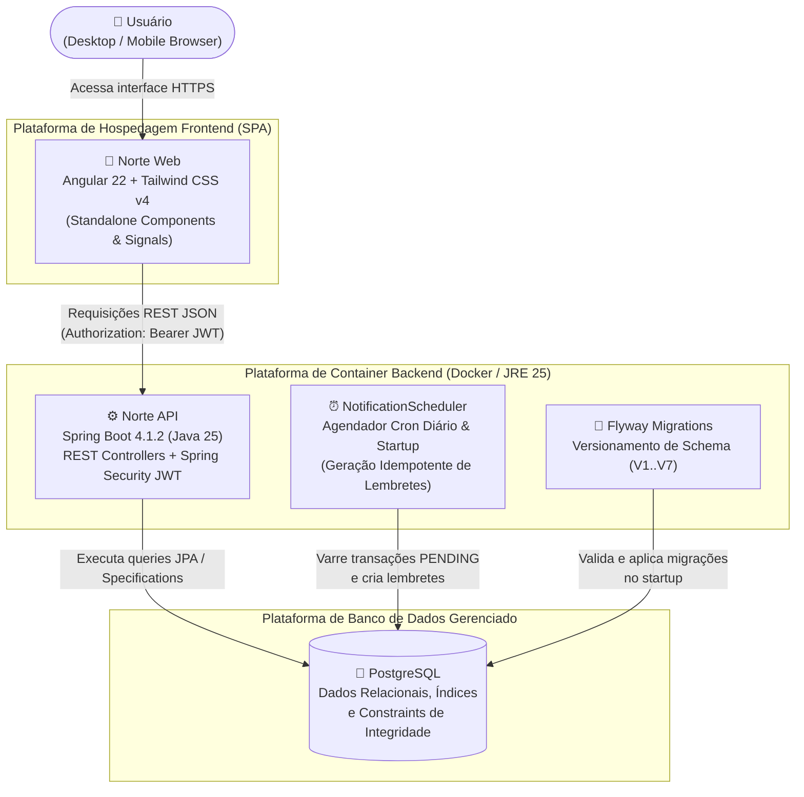
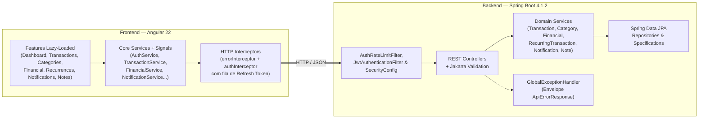
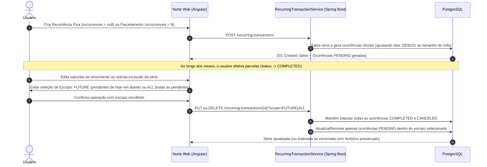
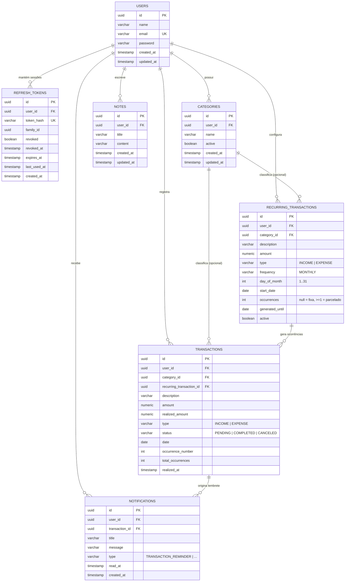

# 🧭 Norte — Gestão e Clareza Financeira Pessoal

> **Organize seu presente financeiro e projete seu futuro com clareza.**  
> O **Norte** é uma plataforma web completa para controle de finanças pessoais que une registro de movimentações avulsas, automação inteligente de recorrências e parcelamentos, visão financeira consolidada (realizada vs. projetada), lembretes automáticos de vencimento e caderno de anotações pessoais.

---

## 📸 Demonstração Visual (Screenshots)

> *Espaço reservado para capturas de tela da aplicação em funcionamento (Temas Claro e Escuro).*

| Visão Geral (Dashboard — Tema Claro) | Visão Geral (Dashboard — Tema Escuro) |
| :---: | :---: |
|  |  |

| Transações e Filtros | Recorrências e Parcelamentos |
| :---: | :---: |
|  |  |

| Indicadores e Análise por Categoria | Central de Lembretes e Anotações |
| :---: | :---: |
|  |  |

---

## 🎯 Visão Geral do Produto

Muitas ferramentas de finanças pessoais pecam por extremos: ou são planilhas manuais que exigem recadastrar as mesmas contas todos os meses, ou são sistemas excessivamente complexos que misturam dinheiro efetivamente disponível em caixa com compromissos futuros ainda não pagos.

O **Norte** foi concebido para resolver essa dor com foco em **simplicidade operacional e precisão contábil pessoal**:

1. **Separação clara entre Realizado e Projetado**: O usuário sabe exatamente quanto possui em caixa hoje (**Saldo Realizado**) e quanto terá após a liquidação das entradas e despesas previstas para o período (**Saldo Projetado**).
2. **Valor Previsto vs. Valor Efetivado**: Compromissos pendentes (como uma conta de energia ou fatura estimada) podem ser efetivados em 1 clique mantendo o valor previsto ou informando o valor real pago/recebido (`realizedAmount`), preservando a fidelidade do histórico.
3. **Motor Unificado de Recorrências e Parcelamentos**: Elimina o retrabalho mensal gerando automaticamente tanto despesas/receitas contínuas (ex.: Aluguel, Salário, Internet) quanto compras ou recebimentos parcelados (ex.: `1/10` a `10/10`), com tratamento inteligente de meses mais curtos (clamping de calendário para dias 29, 30 e 31).

---

## 💡 Proposta de Valor e Funcionalidades Principais

- **Autenticação Segura, Refresh Tokens e Isolamento de Dados**: Cadastro e login com **Rate Limiting** por IP, emissão de Access Token JWT de curta duração (15 min) acompanhado de **Refresh Token opaco** armazenado como hash SHA-256 com **rotação por uso**, **detecção de reutilização de tokens antigos** (invalidando toda a família de sessão), expiração por inatividade (7 dias) e absoluta (30 dias), revogação no logout, validação de senha compatível com o limite UTF-8 de 72 bytes do BCrypt e isolamento rigoroso de dados por usuário (`userId`).
- **Gestão Completa de Entradas e Despesas (`/transactions`)**:
  - Criação rápida de entradas (padrão `PENDING`) e despesas (padrão `COMPLETED`).
  - Filtros combinados por tipo, status, categoria, série recorrente e intervalo de datas.
  - Fluxo dedicado de efetivação (`PATCH /complete`) e cancelamento (`PATCH /cancel`).
- **Classificação Inteligente por Categorias (`/categories`)**:
  - Criação de categorias na página dedicada **ou inline** diretamente no formulário de transação/recorrência.
  - **Exclusão com preservação de histórico**: Categorias sem vínculos são removidas fisicamente; categorias que já possuem lançamentos ou recorrências são inativadas (`active = false`) para nunca quebrar o histórico financeiro.
- **Indicadores Financeiros e Drill-down (`/financial`)**:
  - Cálculo de saldo atual, saldo projetado, resultado líquido realizado e projetado do período.
  - Ranking de participação por categoria com modal de detalhamento (*drill-down*) listando os lançamentos de cada categoria.
- **Automação de Recorrências Fixas e Parcelamentos (`/recurrences`)**:
  - Suporte a recorrências contínuas (janela móvel de 12 meses) e parcelamentos com número fixo de parcelas.
  - Edição e encerramento controlados por escopo (`FUTURE` — apenas pendentes a partir de hoje; ou `ALL` — todas as pendentes), garantindo que parcelas já pagas/recebidas (`COMPLETED`) ou canceladas (`CANCELED`) jamais sejam adulteradas.
- **Dashboard Centralizado (`/dashboard`)**:
  - Visão mensal como padrão e alternância rápida para visão **Trimestral**, **Anual**, **Todo o período** ou **Personalizada**, com navegação entre períodos passados e futuros.
  - Termômetro Realizado vs. Projetado, distribuição por categoria (Despesas/Entradas) e lista de compromissos pendentes com efetivação em 1 clique.
- **Prevenção de Esquecimentos e Organização Pessoal (`/notifications` & `/notes`)**:
  - Agendador diário no backend (`NotificationScheduler`) que gera lembretes automáticos e idempotentes para compromissos pendentes.
  - Sino de notificações no topo da aplicação com contador reativo de itens não lidos.
  - Caderno de anotações pessoais com busca textual instantânea (debounce de 300ms) por título ou conteúdo.
- **Experiência Visual Adaptável**: Suporte completo a **Tema Claro** e **Tema Escuro** com persistência de preferência.

---

## 🏗️ Arquitetura do Sistema (Diagramas C4 & Fluxos)

### 1. Diagrama de Contexto e Containers (C4 Model)

O projeto adota uma arquitetura desacoplada preparada para deploy distribuído em três plataformas independentes (Frontend SPA, Backend API Container e Banco de Dados Gerenciado):



---

### 2. Arquitetura Interna de Módulos (Frontend ↔ Backend)



---

### 3. Fluxo do Motor de Recorrências e Preservação de Histórico

Um dos diferenciais técnicos do **Norte** é seu motor de recorrências e parcelamentos com controle de escopo (`RecurrenceScope`):



---

### 4. Modelo Entidade-Relacionamento (Banco de Dados)



---

## 🛠️ Stack Tecnológica Completa

| Camada | Tecnologias |
| :--- | :--- |
| **Backend** | Java 25, Spring Boot 4.1.2, Spring Security, Spring Data JPA (Hibernate), Bean Validation, Flyway, JJWT (`0.12.6`), SpringDoc OpenAPI 3 (`3.2.0`), Maven |
| **Frontend** | Angular 22.2 (Standalone Components, Signals, Reactive Forms), TypeScript 6.0, Tailwind CSS 4.2, RxJS 7.8 |
| **Banco de Dados** | PostgreSQL |
| **Testes** | JUnit 5, MockMvc, Spring Security Test (Backend) • Vitest 5.0, Angular TestBed (Frontend) |
| **DevOps / Deploy** | Docker (Multi-stage build para o Backend com Eclipse Temurin 25 Alpine) |

---

## 📂 Estrutura do Repositório

```text
Norte/
├── README.md                 # Documentação global do produto e arquitetura (este arquivo)
├── backend/                  # API RESTful em Spring Boot 4.1.2 + Java 25
│   ├── Dockerfile            # Build multi-stage para deploy do backend em container
│   ├── env.example           # Exemplo de variáveis de ambiente do backend
│   ├── pom.xml               # Configuração Maven e dependências
│   ├── README.md             # Guia específico de execução, variáveis e endpoints do backend
│   └── src/                  # Código-fonte Java, migrações Flyway (V1..V7) e testes de integração
└── frontend/                 # Aplicação SPA em Angular 22 + Tailwind CSS v4
    ├── env.example           # Exemplo de variáveis de ambiente do frontend
    ├── package.json          # Scripts npm e dependências
    ├── README.md             # Guia específico de execução, temas e deploy do frontend
    ├── scripts/set-env.mjs   # Script de injeção de variáveis de ambiente no Angular
    └── src/                  # Código-fonte Angular e testes unitários Vitest
```

---

## 🚀 Guia Rápido de Execução Local

Para instruções detalhadas de cada módulo, consulte os guias específicos:
- 📘 **[Guia do Backend (`backend/README.md`)](backend/README.md)**
- 📗 **[Guia do Frontend (`frontend/README.md`)](frontend/README.md)**

### Passo a passo resumido:

1. **Banco de Dados (PostgreSQL)**:
   Crie um banco de dados local chamado `norte` no PostgreSQL.

2. **Subir o Backend (`http://localhost:8080`)**:
   ```bash
   cd backend
   cp env.example .env
   # Preencha DB_URL, DB_USER, DB_PASSWORD, JWT_SECRET e demais variáveis no arquivo .env
   ./mvnw spring-boot:run -Dspring-boot.run.profiles=dev
   ```

3. **Subir o Frontend (`http://localhost:4200`)**:
   ```bash
   cd frontend
   cp env.example .env
   npm install
   npm start
   ```

4. Acesse `http://localhost:4200` no navegador, crie sua conta e comece a utilizar o **Norte**.

---

## ☁️ Estratégia de Deploy em Produção

O projeto está preparado para publicação distribuída em **três plataformas especializadas**:

1. **Banco de Dados (PostgreSQL Gerenciado)** — *ex.: Neon, Supabase, Railway Postgres, Render Postgres*:
   - Provisione a instância PostgreSQL e copie as credenciais (`DB_URL` em formato JDBC, `DB_USER` e `DB_PASSWORD`).
   - Não é necessário rodar scripts SQL manualmente: o **Flyway** aplica automaticamente as migrações `V1` a `V7` quando o backend iniciar.

2. **Backend (Container Docker)** — *ex.: Render, Railway, Fly.io, Koyeb*:
   - Aponte o serviço para o diretório `backend/` utilizando o [`backend/Dockerfile`](backend/Dockerfile).
   - Configure as variáveis de ambiente listadas em [`backend/README.md`](backend/README.md), definindo `CORS_ALLOWED_ORIGINS` com a URL pública do seu frontend (ex.: `https://norte.vercel.app`).

3. **Frontend (Static Hosting / CDN)** — *ex.: Vercel, Netlify, Cloudflare Pages*:
   - Aponte para o diretório `frontend/`, com comando de build `npm run build` e diretório de publicação `dist/norte-frontend/browser`.
   - Configure a variável de ambiente `API_URL` apontando para a URL pública do seu backend.
